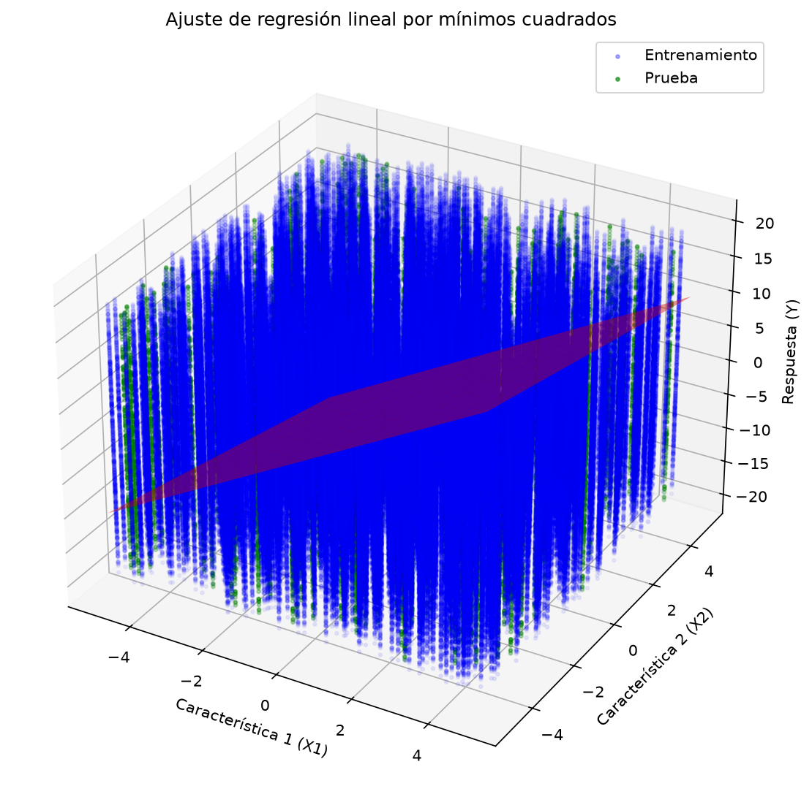
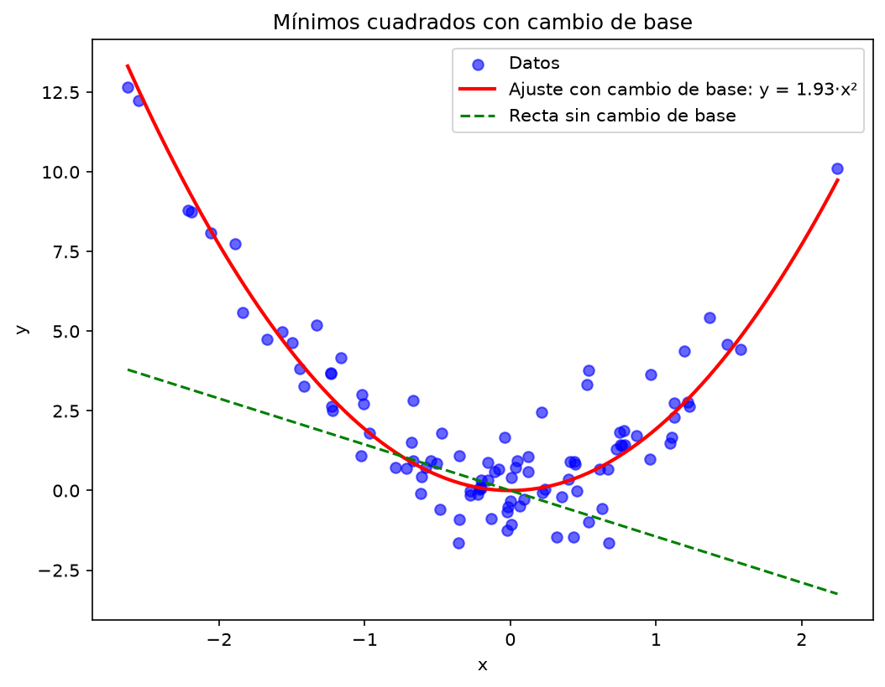

# Unidad 4: Regresión lineal

Prácticas de regresión lineal con mínimos cuadrados y cambio de base.

## P01: Regresión lineal con mínimos cuadrados
Se generan 1000 datos sintéticos con dos atributos, se separan en entrenamiento (80 %) y prueba (20 %), y se estiman los parámetros con:

θ = (XᵀX)⁻¹ Xᵀ y

Resultado: θ estimado ≈ [3.0, -1.0] (real: [3, -1]) y error cuadrático medio en prueba ≈ 0.01.

## P02: Regresión no lineal (cambio de base)
Los datos siguen una parábola, así que se cambia de base de x a x² y se aplica mínimos cuadrados.

Resultado: θ estimado ≈ 2 (real: 2). El error baja de ≈ 13 (recta) a ≈ 1 (con cambio de base).

## Archivos
- `P01_Regresion_lineal_miminos_cuadrados.ipynb`
- `P02_Regresion_no_lineal.ipynb`

## Cómo ejecutarlo
    pip install jupyter numpy matplotlib
    jupyter notebook